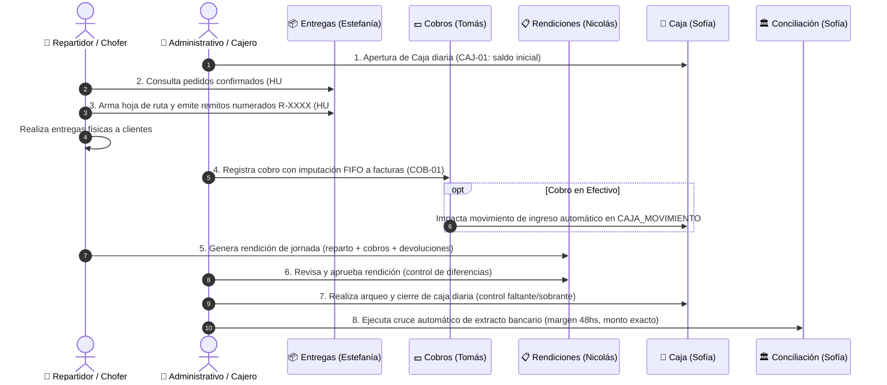
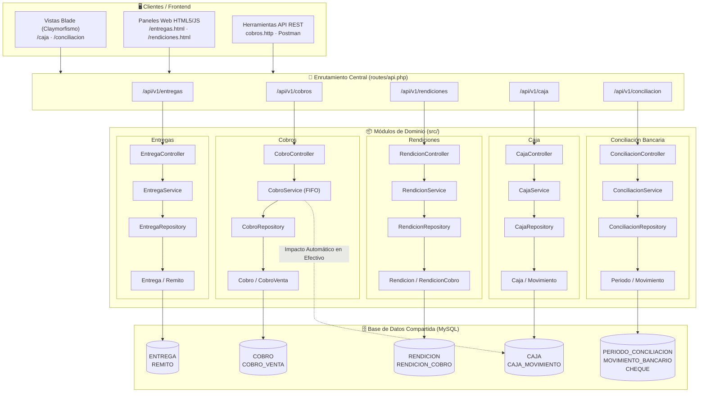

# 🚀 Plan de Presentación y Validación — Sprint 3 (Grupo 2)

**Integrantes:** Estefanía Gianovich, Nicolás, Sofía Pizzano, Tomás Guanes  
**Fecha:** Octubre 2026  
**Módulos:** Entregas, Facturación (planificada), Cobros, Rendiciones, Caja, Conciliación Bancaria  

---

## 🧭 1. Flujo Integrado de Negocio del Grupo 2

El siguiente diagrama ilustra cómo colaboran e interactúan los módulos desarrollados por cada integrante para cumplir el circuito operativo de la distribuidora:



---

## 🏛️ 2. Arquitectura Técnica del Sistema

El Grupo 2 opera bajo un **Monolito Modular** en Laravel 12 con bajo acoplamiento, convención **PSR-4** (`App\` $\rightarrow$ `src/`) y separación de responsabilidades en 4 capas:



---

## 🎤 3. Guion de Exposición para la Presentación (10 a 15 min)

### Parte 1: Introducción y Arquitectura General (2 min) — *Todo el equipo / Portavoz*
* **Qué destacar:**
  1. Adopción exitosa de **Laravel 12** con estándar PSR-4 sin código procedural legacy.
  2. Arquitectura **Monolito Modular** en 4 capas (`Controller` $\rightarrow$ `Service` $\rightarrow$ `Repository` $\rightarrow$ `Model`).
  3. Contratos de **API REST versionados (`/api/v1`)** y respuestas unificadas en formato JSON.
  4. Respeto estricto de la **propiedad de datos**: cada módulo gestiona sus tablas sin romper los dominios de otros grupos.

---

### Parte 2: Demostración Módulo por Módulo (8-10 min)

#### 🚚 1. Entregas y Logística (Estefanía Gianovich)
* **Qué mostrar en vivo:**
  * Abrir en el navegador: `http://localhost:8000/entregas.html`.
  * Mostrar cómo se listan los pedidos pendientes filtrados por zona (HU #1).
  * Seleccionar pedidos y generar una entrega: mostrar la creación automática del **Remito con numeración formal `R-XXXX-XXXXXXXX`** (HU #2).
  * Mostrar cómo los pedidos cambian de estado y quedan asociados al repartidor.

#### 💵 2. Cobros y Cuenta Corriente (Tomás Guanes)
* **Qué mostrar en vivo:**
  * Mostrar el archivo `cobros.http` o ejecutar mediante Postman/curl un registro de cobro (`POST /api/v1/cobros`).
  * Destacar el **Algoritmo FIFO de Imputación Progresiva**: cómo un pago parcial o total salda primero las facturas más antiguas registradas en `COBRO_VENTA`.
  * **Punto fuerte de integración:** Mostrar que si el medio de pago es `efectivo`, automáticamente se registra un movimiento de entrada en `CAJA_MOVIMIENTO` dentro de la misma transacción atómica (`DB::transaction`).
  * Consultar el saldo del cliente en tiempo real (`GET /api/v1/cobros/clientes/{id}/saldo`).

#### 📋 3. Rendiciones de Reparto (Nicolás)
* **Qué mostrar en vivo:**
  * Abrir en el navegador: `http://localhost:8000/rendiciones.php` (o `rendiciones.html`).
  * Mostrar el panel visual con diseño Claymórfico y tabla sin scroll horizontal.
  * Cargar una rendición con cobros desglosados por medio de pago (efectivo, transferencias, cheques).
  * Registrar una devolución o registrar una diferencia (sobrante/faltante).
  * Cerrar y revisar la rendición cambiando su estado a aprobada.

#### 🏦 4. Caja y Conciliación Bancaria (Sofía Pizzano)
* **Qué mostrar en vivo:**
  * **Caja:**
    * Abrir `http://localhost:8000/caja`.
    * Mostrar la **Apertura de caja** (`CAJ-01`) con validación de no permitir duplicados por usuario/día.
    * Ver los movimientos del día (`CAJ-02`), incluyendo el cobro en efectivo generado en el módulo de Tomás.
    * Mostrar el **Historial de cierres** (`CAJ-03` / `CAJ-04`) con filtro de fechas y arqueo de diferencias.
  * **Conciliación Bancaria:**
    * Abrir `http://localhost:8000/conciliacion`.
    * Mostrar la pantalla de períodos de conciliación.
    * Explicar el **Motor de Conciliación Automática**: cruce con regla de tolerancia de 48hs, monto exacto y descarte por ambigüedad.
    * Mostrar el módulo de **Cheques**: alta, depósito y rechazo con reversión contable automática.

---

### Parte 3: Calidad y Pruebas Automatizadas (2 min) — *Tomás / Sofía*
* **Qué mostrar en la consola:**
  * Ejecutar el comando de tests unitarios:
    ```bash
    vendor/bin/phpunit tests/Unit/CobroServiceTest.php
    vendor/bin/phpunit tests/Unit/RendicionServiceTest.php
    ```
  * Mostrar que los tests de negocio pasan al **100% de efectividad**.

---

### Parte 4: Cierre y Próximos Pasos para el Sprint 4 (1 min)
* **Puntos a mencionar:**
  1. **Integración Cruzada Entregas-Cobros (`[G2]-COB-04`):** Conectar los cobros pendientes directamente en la hoja de ruta del repartidor en `entregas.html`.
  2. **Anulación de Cobros (`[G2]-COB-03`):** La estructura relacional y campos de auditoría ya están en la base de datos; se habilitará la reversión en el Sprint 4.
  3. **Facturación:** Alinear con el Grupo 4 (Ventas) una vez definidos sus contratos para conectar la emisión de facturas.

---

## 📋 4. Checklist Técnico de Verificación Previa

Antes de conectar el proyector o compartir pantalla:

- [ ] **Base de Datos MySQL:** Servidor MySQL corriendo y accesible.
- [ ] **Variables de entorno:** Archivo `.env` configurado con credenciales de base de datos.
- [ ] **Migraciones aplicadas:** Ejecutar `php artisan migrate` para garantizar que las tablas de los 4 integrantes existan en la base local.
- [ ] **Servidor Web activo:** Servidor corriendo mediante `php artisan serve` o `php -c php.ini -S localhost:8000 -t public`.
- [ ] **Pestañas del navegador listas:**
  1. `http://localhost:8000/entregas.html` (Entregas)
  2. `http://localhost:8000/rendiciones.php` (Rendiciones)
  3. `http://localhost:8000/caja` (Caja)
  4. `http://localhost:8000/conciliacion` (Conciliación)
- [ ] **Cliente HTTP listo:** Archivo `cobros.http` abierto en VS Code con REST Client o colección de Postman preparada.
- [ ] **Consola limpia:** Terminal abierta en la raíz con el comando `vendor/bin/phpunit` listo para ejecutar.
